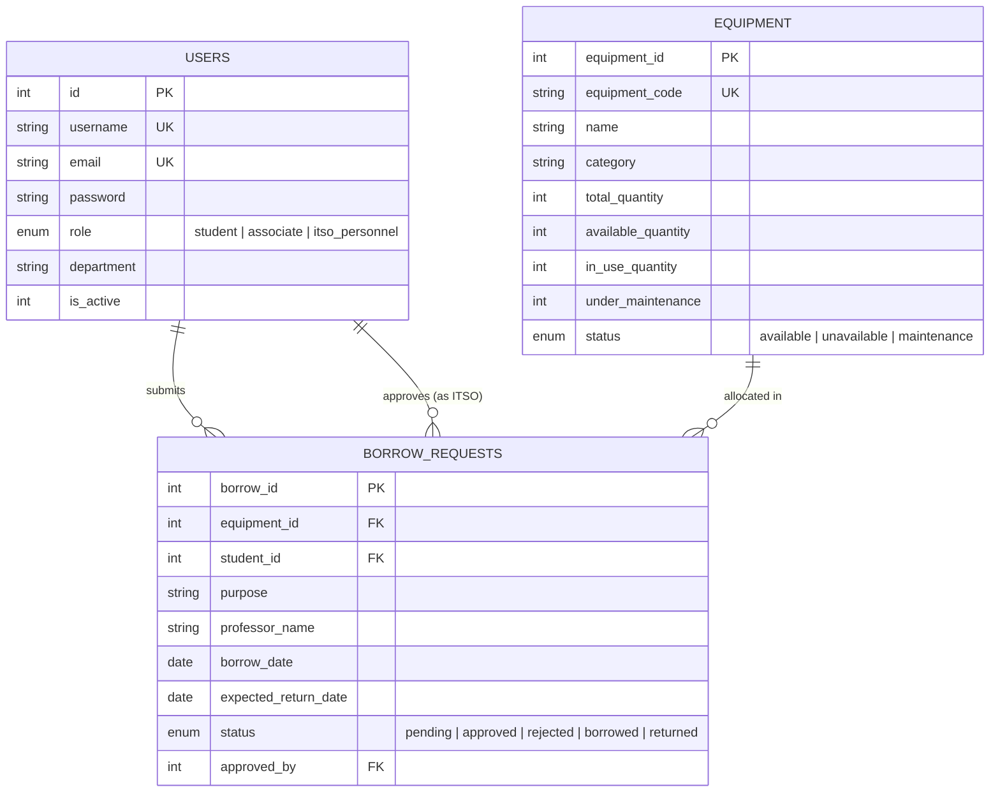

<div align="center">

# 📦 ITSO Equipment Management System (ITSO EMS)
**An Enterprise Academic Equipment Inventory, Reservation & Loan Lifecycle Platform**

[](https://www.php.net/)
[](https://codeigniter.com/)
[](https://www.docker.com/)
[](https://www.mysql.com/)
[](LICENSE)

<br/>

> Built for the **Institute of Technology Services Office (ITSO)** at **FEU Institute of Technology** to streamline the end-to-end loaning, reservation, tracking, and maintenance of academic laboratory equipment.

</div>

---

## 📌 Executive Overview

The **ITSO Equipment Management System (ITSO EMS)** is a production-ready, full-stack web platform engineered to eliminate manual paper slips, equipment loss, and reservation conflicts across university departments. 

It provides an automated inventory tracking engine that updates equipment availability in real-time, powers multi-tiered role authorization (Students, Faculty Associates, and ITSO Administrators), enforces academic borrowing policies, and generates analytical audit reports.

---

## 👩‍💻 Role & Leadership

**Role:** Project Lead & Full-Stack Developer  
**Developer:** [Althea Zuleika Sadicon](https://github.com/briee1w)  
**Academic Focus:** BSIT — Web and Mobile Application Development, FEU Tech

### Key Contributions:
- **Project Leadership & Architecture:** Led the development lifecycle from conceptual wireframing and database normalization to cloud deployment.
- **Backend Architecture & Security:** Designed MVC controllers, models, authentication filters (RBAC), CSRF protection, and session security in CodeIgniter 4.
- **Database Engineering:** Modeled the relational schema across equipment, users, and borrowing lifecycles with dual driver support (SQLite for zero-config demos and MySQL/MariaDB for cloud scaling).
- **DevOps & Containerization:** Authored production Docker images on Debian with Apache, dynamic port binding, and automated deployment pipelines for Render.
- **Frontend & UI/UX:** Crafted a responsive interface adhering to FEU Tech's institutional color palette (Forest Green & Gold) with real-time role badges and dynamic modals.

---

## 🛠️ Technologies & Tools

| Layer | Technologies & Tools |
| :--- | :--- |
| **Backend Framework** | PHP 8.2+, CodeIgniter 4 (MVC Architecture, PSR-4 Autoloading) |
| **Frontend** | Semantic HTML5, Vanilla CSS3 (Custom Design System), JavaScript (ES6+), Google Fonts |
| **Database** | SQLite3 (Preloaded Embedded DB) & MySQL / MariaDB (Multi-Driver DB Architecture) |
| **DevOps & Hosting** | Docker, Apache (`mod_rewrite`), Render Web Services, Git / GitHub |
| **Security & Standards** | Bcrypt Password Hashing, CSRF Protection, Input Validation Filters, RBAC |

---

## ✨ Core Features & Workflows

### 1. 🛡️ Role-Based Access Control (RBAC)
- **ITSO Personnel (Admin):** Full administrative authority. Manage inventory, approve/reject borrow requests, log equipment maintenance, generate exportable reports, and manage user accounts.
- **Faculty / Associates:** Priority borrowing privileges with extended borrowing limits for classroom and research use.
- **Students:** Browse catalog of available hardware, submit loan requests for academic subjects, and monitor real-time approval status.

### 2. 📋 Equipment Inventory & Lifecycle Tracking
- Tracks laptops, DLP projectors, remote controls, HDMI/VGA cables, and drawing tablets.
- Real-time stock calculation (`total_quantity`, `available_quantity`, `in_use_quantity`, `under_maintenance`).
- Automatic status transitions: flags equipment as `available`, `unavailable`, or `maintenance` based on live availability thresholds.

### 3. 🔄 Borrowing & Reservation Workflow
- Request submission specifying purpose (class, lab experiment, research), professor, and room number.
- One-click approval, rejection, and return check-in by ITSO Personnel with automatic stock replenishment.

### 4. 📊 Audit & Analytical Reporting
- Exportable audit logs for:
  - Active equipment in circulation
  - Unusable / under-maintenance inventory
  - Complete historical borrowing logs with date filters

---

## 🚀 Live Demo & Demo Accounts

Try out the live deployment directly in your browser:

### 🔑 Test Credentials:

Click any **role badge** on the login page to auto-fill demo credentials, or sign in using:

| Role | Username / Email | Password | Access Level |
| :--- | :--- | :--- | :--- |
| **ITSO Personnel** | `itso_admin` | `admin123` | Full administrative control & report generation |
| **Associate / Faculty** | `faculty_user` | `faculty123` | Priority reservation & extended loan periods |
| **Student** | `student_user` | `student123` | Equipment catalog browsing & loan requests |

> *Team lead account: `altheaxzuleika` / `Password123!`*

---

## 🏗️ Architecture & Database Design



---

## 💻 Local Installation & Setup

### Option A: Standard PHP Local Server
```bash
# 1. Clone the repository
git clone https://github.com/briee1w/itso-equipment-management.git
cd itso-equipment-management

# 2. Start the built-in development server (SQLite is pre-configured)
php spark serve
```
Visit `http://localhost:8080` in your browser.

---

### Option B: Docker Deployment
```bash
# Build the Docker image
docker build -t itso-ems .

# Run the container
docker run -p 8080:80 itso-ems
```
Visit `http://localhost:8080` in your browser.

---

## 👥 Development Team

- **Althea Zuleika Sadicon** — Project Leader & Full-Stack Developer ([@briee1w](https://github.com/briee1w))
- **Khristian Jose Guinto** — Backend Developer & Database Architect
- **Jan Rodmil Santos** — Backend Developer

---

<div align="center">
  <sub>Developed for academic fulfillment at FEU Institute of Technology • BSIT Program</sub>
</div>
